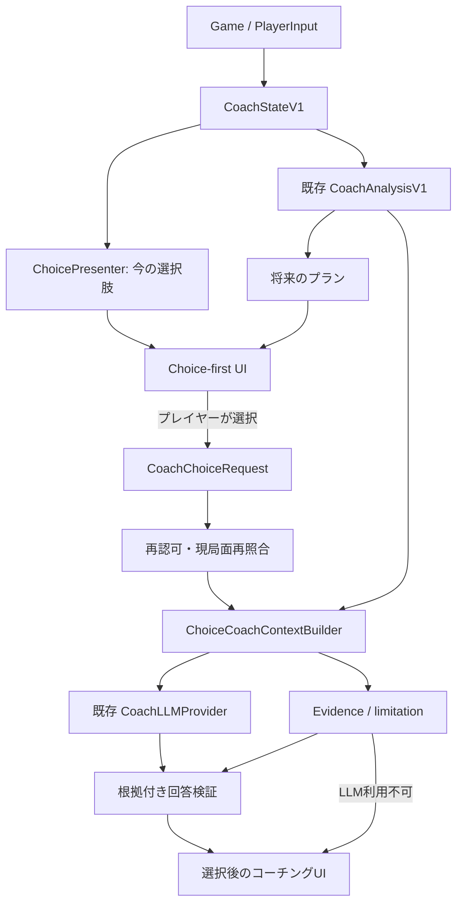

# TM-COACH-P3-CD — Phase 3 選択主導型AI戦略コーチ 実装計画

- ステータス: **実装提案 / Claude Codeへの引継ぎ用**
- 作成日: 2026-10-16
- 対象: `yusei88/terraforming-mars`
- 参照基準: `main` の `5e60b14887e1a07230c59e037f6c0a2948d07209`（PR #8、Iteration 0マージ）
- 本計画の位置づけ: `docs/coach/phase3/plan.md` の **Iteration 1以降のユーザー体験・優先順位・モデル評価基準を変更**する。Iteration 0の成果物は残す。矛盾時には本計画を優先し、決定事項をADRに追記する。
- 実装主体: Claude Code。ゲームのルール・既存ロジックを正本とし、コーチは**読み取り専用**。

## 0. エグゼクティブサマリー

### プロダクトの定義

> **ゲームが提示している選択肢をプレイヤー自身が選び、その選択をAIが数手先の影響・成立条件・機会損失から検討し、プレイヤーの戦略判断を育てる「選択主導型の戦略コーチ」。**

「AIが最善手を最初に推薦する」「AIと自由チャットする」をメイン画面にしない。**最初に選ぶのは人間**。ただしAIは迎合しない。選択が弱い、条件を満たさない、機会損失が大きいと思われる場合には、検証できる理由と制約を添えて指摘する。

### 開発の原則

1. **早い縦切り**: 選択肢を開く→選ぶ→コーチング→ゲームへ戻る、までを先に動作させる。完璧な探索・会話を待たない。
2. **二種類の選択肢を混同しない**: `今すぐ実行できる合法手` と `将来を見据えた戦略プラン` を別グループで表示。
3. **選ぶこと≠実行すること**: コーチ画面の選択・確認はゲームを一切更新しない。実行は従来のゲームUIだけ。
4. **ルールをLLMに再計算させない**: 合法性・費用・カード効果・確定的未来は既存ゲーム/分析エンジンから取得。LLMは戦略的な評価・説明・問いかけを担当する。
5. **根拠の限界も見せる**: 現エンジンは最大3枚のカード連鎖と0〜3生産フェーズの条件付き予測。最適解・勝率の保証はしない。
6. **評価して進化**: 初期MVP後は実利用に基づき、選択肢の不足、分析精度、AIコーチング、UIのどこを改善するか判断する。

### 主要なDone判定

ソロの複数世代を含む実プレイにおいて、**「現時点の選択肢を見る→1つ選ぶ→強み・弱み・数手先・問いを確認する→選び直す/ゲームを続ける」が支障なく繰り返せる**。根拠のない数値を断定せず、LLM障害でもゲームが動き続ける。

## 1. 現状と再利用する資産（検証済み）

| 領域 | 現状 | 再利用・変更方針 |
|---|---|---|
| `CoachStateV1` | `src/extensions/coach/common/CoachState.ts`。本人に見えるゲーム状態と `choices`（`awaiting-input` / `waiting-for-others` / `resolving` / `game-over`） | 選択肢の元データとして再利用。選択肢の正確な性質は型ごとに検証 |
| 選択入力の正規化 | `src/extensions/coach/server/choices.ts`。入れ子の`or/and/initialCards`、`card/projectCard/option/space/payment/...`等と`path` | 新規 `ChoicePresenter` はここから構築。対応できない型は安全に表示不能/分析不能とする |
| `CoachAnalysisV1` | `GET api/coach/analysis?id=...&horizon=0..3`。最大3枚のプラン、費用・条件・予測、未対応情報、候補は最大9件 | 将来プランと既知の先読み根拠として再利用。プランは「今の合法手」ではない |
| Gate F UI | `src/extensions/coach/client/CoachPanel.vue` と `coachText.ts`。上部バー直下の小型分析パネル、翻訳済み表示 | **パネルを拡張**。ゲームのボトムシート/Undo/ナビを塞がない配置を維持 |
| Iteration 0のAI基盤 | `CoachChat.ts`、`contextBuilder.ts`、`instructions.ts`、`replyValidator.ts`、`CoachLLMProvider`、OpenAI/Sarashina接続 | 再利用するが、**自由質問→選択に対するコーチング**へ契約・指示・ベンチマークを更新 |
| モデル評価 | 24テスト局面/106問、4モデル比較。`gpt-6.1-sol`がADR上の標準 | **暫定採用**に訂正。戦略コーチング性能を測れていないので最終決定は保留 |
| ゲーム内部 | `Game.serialize()`/`deserialize()` 等が存在 | 仮想実行の候補だが、`serialize()` は `deferredActions: []`。任意の選択途中の完全複製を前提にしない |

主要参照: `docs/coach/phase3/{plan.md,report.md,adr-provider.md,ux-decision.md,evaluation-dataset.md}`、`docs/coach/phase2-{design,gaps,qa}.md`、`CLAUDE.md`。

## 2. ユーザー体験とスコープ

### 2.1 主画面の流れ

1. プレイヤーがコーチを1操作で開く（既存のメニュー入口も維持）。
2. 見出し「**今できる行動**」の下に、ゲームが現在受け付ける選択を表示。必要に応じて「**将来を見据えたプラン**」も別に表示。
3. プレイヤーが具体的なカード・標準プロジェクト等の**選択肢**、または分析済みの**戦略プラン**を選択。
4. AIを呼ぶ前に、費用、合法/条件付き、分析可能範囲などの**確定事実を即時表示**する。
5. 「この選択を検討する」を押すと、選択を中心にLLMが考察。画面には以下を短く表示する:
   - その選択の**狙い・強み**
   - **数手先または数生産フェーズ先**の影響（ゲームエンジンに根拠がある部分のみ）
   - **弱み・機会損失・不確実性**
   - プレイヤーが考えるための**問いを1つ**
6. プレイヤーは「別の選択肢と比較」「根拠を見る」「選び直す」を使える。**自由入力は補助/折りたたみ**。
7. パネルを閉じてもゲームの入力は変わらない。ゲームで実行した後は局面更新を検知し、旧コーチングを新局面の助言として見せない。

### 2.2 主な画面状態

```
閉じる
  ↓ 起動
選択肢一覧 [今できる行動 / 将来のプラン]
  ↓ 選ぶ（ゲーム操作はしない）
選択内容と確定事実 [費用/可否/関係/分析限界]
  ↓ この選択を検討する
コーチング中 → 回答 [強み/リスク/先読み/問い/根拠]
                  ├ 他案比較
                  ├ 別の案を選ぶ
                  ├ 自由質問（任意・後回し可）
                  └ ゲームへ戻る
```

ロード/失敗/AI未許可/予算超過/局面変更/入力がない状態は**データ付きのフォールバック**を表示する。待ち状態に無理に「合法手」を作らない。

### 2.3 二つのグループ（必須）

| グループ | 定義 | 根拠と注意 |
|---|---|---|
| **今できる行動 (Now)** | サーバーが今そのプレイヤーに提示する `CoachChoices` 中の入力候補 | `projectCard` 等は入力フェーズを区別。`card` は購入・選択・青カードアクション等になり得る。ネストした選択や複数カード一括選択は単一アクションと断定しない |
| **将来を見据えたプラン (Future)** | Phase 2の`CandidatePlan` | カード1〜3枚の候補。`conditional`/`unknown`は今すぐ実行可能ではない。探索上限や未モデル化の影響を明示 |

「経済・コンボ・得点・テラフォーミング」は分類/フィルタであり、具体的な選択の代替にしない。選択肢が多い場合はカテゴリ折りたたみ・検索・上位表示を利用し、**省略された選択肢があることを隠さない**。

### 2.4 非目標（MVP）

- AIによる自動プレイ、従来ゲームUIの置換、未承認のデータ送信。
- 完全情報による山札や対戦相手の手札の先読み、厳密な勝率/最適解保証。
- すべての拡張カード・マス配置・特殊な選択の完全分析。
- フル音声、長期人格、複数AIエージェント、高度な自由会話UI。
- 全ゲーム状態を無条件に`serialize→deserialize`して探索。Deferred Actionと非公開情報の検証なしに導入しない。

## 3. 要件と受入条件

### F01 具体的な選択肢提示
- サーバーから選択肢一覧を生成する。クライアントは任意の`choiceId`を捏造しても受理されない。
- 表示対象は**現在の本人の選択**。他プレイヤーのターン・解決中・終局時には適切な状態を表示する。
- ネストした`or/and/initialCards`、`card`/`projectCard`/`option`等は、**元入力の意味を変えず**に表示する。対応範囲を明示する。
- 「今できる行動」には現在の合法性が確認できた選択だけを載せ、条件付き・不明は専用区分へ退避する。
- 非公開の情報をプレイヤー画面・LLM・ログに漏らさない。

### F02 プレイヤーによる選択
- 選択肢押下で`selectedChoiceId`と分析対象の局面トークンを保持。
- 「検討する」のみがAI通信を開始する。選択時点でゲームサーバーの入力処理を呼び出さない。
- 本人の意思決定を誘導しないよう、**選択前にAIが「これが最善」と表示しない**。

### F03 選択に対するコーチング
- データの裏付けがある**強み、注意点、先読み、考えるための問い1つ**。強みが示せない場合は無理に作らず「確認できる強みはない」とする。
- 検討した選択に不利な材料も提示する。賛同のみで終わらせない。
- 別の候補との比較は**表示済みの選択肢から**プレイヤーが指定できる。
- 回答に選択した候補、参照した根拠、未知部分の状態を添える。
- 自由質問は任意で後回しにできる。必要最低限の追質問に限る。

### F04 現実的な先読み
- 初期は既存の1〜3枚プランと0〜3生産フェーズの予測・必要条件だけで説明する。**行動回数の未来**と**生産フェーズ数**を混同しない。
- 本当の分岐探索は独立した検証ゲートで限定的に追加する。正確なシミュレーションができないタイプは`unsupported`。
- 分析できない選択を避けるのではなく「選べるが定量評価はできない」と示す。

### F05 信頼性/安全性/運用
- 既存`CoachPlayerHandler`相当の本人認可、`no-store`、入力バリデーション、CSRF対策をゲームのPOST実装と同じ規約で実現。
- 外部LLMの通信は設定と利用者の**明示的同意**が揃ったときだけ。初期状態はオフ。APIキーはサーバーのみ。
- 権限のあるルートでもプレイヤーID・ゲームID・観戦ID、非公開の山札や他プレイヤーの手札をLLMに渡さない。
- 局面が変わった回答は必ずstale表示、古い最新結果の上書きを防ぐ。Undo、同じ内容の局面への再訪、別ゲームへの切替も試験する。
- タイムアウト/429/不正JSON/検証失敗では既存分析にフォールバック。課金/リクエスト上限、二重リクエスト抑止、キャンセルを扱う。
- コーチ障害はゲームの進行を停止・変更しない。ソロ/対人の双方を試す。

## 4. データ契約の提案（実装前に型とテストで確定）

**独立した版付き契約を追加し、`CoachAnalysisV1`を破壊的に変更しないこと。** 以下は採用候補。型名と経路は現行リポジトリ規約に合わせて調整してよい。

### 4.1 選択肢

`CoachChoiceListV1`（例 `coach-choice-list/1`）:

```ts
type CoachChoiceOption = {
  id: string;                     // サーバー生成の不透明ID。サーバー内で現在局面にひもづける
  group: 'now' | 'future';
  kind: 'project-card' | 'card-selection' | 'game-option' | 'standard-action' |
        'blue-action' | 'space-choice' | 'payment' | 'multi-select' | 'strategy-plan' | 'other';
  titleKey?: string;              // 静的表示を翻訳する場合
  titleParams?: Record<string, string>;
  cardNames?: string[];
  planId?: string;                // 将来プランの場合のみ。クライアント表示用
  eligibility: 'legal-now' | 'conditional' | 'unknown' | 'not-action';
  selectableForCoaching: boolean; // false: 対応外理由のみ表示
  limitations: string[];         // 原因コードを推奨。表示は翻訳
};
type CoachChoiceListV1 = {
  schemaVersion: 'coach-choice-list/1';
  positionToken: string;          // 局面内容・Undo/履歴世代・分析版を組み合わせた再検証用トークン
  analysisVersion: string;
  stateStatus: 'awaiting-input' | 'waiting-for-others' | 'resolving' | 'game-over';
  options: CoachChoiceOption[];
  warnings: string[];
};
```

- **重要**: `choice.path`だけで`legal-now`を決定しない。`and`、複数枚選択、研究フェーズ購入などでは「選択候補」と「単一で実行可能な手」を区別する。最低限、入力型ごとの仕様を調査して契約化する。
- `positionToken`はサーバーが現在の状態に照合できるものとし、秘匿の必要なIDをそのまま埋め込まない。`fingerprint`だけではUndoの文脈管理が不十分になり得るため、`advisoryFingerprint`/ゲーム状態version/Undo等を含む再検証を行う。
- IDはこのユーザーの現在局面内で安定させるが、クライアントのIDからゲーム入力を実行できる仕組みにはしない。
- 戦略プランのIDは局面をまたいで永続的な意味を持たない。UIで選択した後にリフレッシュされた場合、再照合が必要。

### 4.2 コーチングリクエストと回答

提案エンドポイント:

```
GET  /api/coach/options?id=<playerId>
POST /api/coach/counsel?id=<playerId>
```

`POST`の例（概念）:

```json
{
  "schemaVersion": "coach-counsel-request/1",
  "positionToken": "opaque-position-token",
  "choiceId": "opaque-choice-id",
  "mode": "review-choice",
  "compareWithChoiceId": null,
  "language": "jp"
}
```

サーバー処理:

1. ユーザー認可、CSRF/入力制限、同意/予算確認。
2. 最新ゲーム状態から同じ選択肢一覧を再構築し、`positionToken`と`choiceId`を照合（不一致は明確な409相当のstale応答）。
3. 選択した行動に対応する`CoachAnalysisV1`の根拠を収集。
4. AIへ渡す**最小の選択専用コンテキスト**を構築する。内部の選択ID・本物のプランID・プレイヤー秘密IDは外部へ出さず、短い別名と構造化された事実のみ渡す。
5. 必要ならLLMで解説を作り、構造・参照先・数値・unsupported条件を検査。モデル文中の数値がコンテキストのどこかに存在するだけでは不十分なので、**主張と根拠IDの組**を検証する。
6. 返信前にも局面を再確認。移動していた場合はstaleとして返し、新局面の推薦に見せない。
7. 不可/失敗なら**同じ選択に関するサーバー側の事実カード**でフォールバックする。

返信例の形:

```ts
type CoachCounselV1 = {
  schemaVersion: 'coach-counsel/1';
  positionToken: string;
  selectedChoiceId: string;
  status: 'ready' | 'stale' | 'fallback' | 'disabled' | 'error';
  strengths: Array<{text: string; evidenceIds: string[]; support: 'verified' | 'conditional'}>;
  risks: Array<{text: string; evidenceIds: string[]; support: 'verified' | 'conditional'}>;
  outlook: Array<{text: string; evidenceIds: string[]; support: 'verified' | 'conditional'}>;
  reflectionQuestion?: string;
  limitations: string[];
  factCards: Array<{id: string; kind: string; source: string; value: unknown}>;
  modelInfo?: {providerAlias: string; responseMs: number};
};
```

上は設計上の目標であり、初回PRでは`factCards`＋短いコーチメッセージから始めてもよい。**架空の根拠IDを受理しない**。LLMの自由文の因果関係は機械的に完全検証できないため、自動検証と人手評価の両方を用意する。

### 4.3 選択後のコーチング方針

- 強み・弱み・先読みは、**観測**／**検証済みの推計**／**条件付き仮説**／**未対応**を区別。
- 現時点では「最善手」「勝率x%」「確実な回収」は原則使わない。限定された選択群を同条件で確定的に比較できた場合のみ「今回の比較ではAが優位」と表現できる。
- 数字は対応する事実（例:カードAの費用、予測の生産指数）を特定できた場合のみ使う。
- 一つの問いを示す。「なぜ選んだのですか？」のような機械的な問いだけでなく、実際に変わる制約（残り生産、支払資源、タグ条件）に焦点を当てる。
- モデルが推測した弱点・機会損失は未検証の断定にしない。検証できない比較は「比較材料が不足」とする。

## 5. アーキテクチャ



推奨する実装分割（実際の名称は既存規約に合わせる）:

| 層 | 追加・変更の候補 |
|---|---|
| `common` | `CoachChoiceList.ts`, `CoachCounsel.ts`（版付き型と状態） |
| `server` | `choices/choicePresenter.ts`, `chat/choiceContextBuilder.ts`, `chat/choiceCoachingPolicy.ts`, `chat/evidenceVerifier.ts`, `routes.ts` |
| `client` | 既存`CoachPanel.vue`拡張、`CoachChoiceList.vue`、`CoachChoiceReview.vue`、`CoachEvidence.vue` |
| `tests` | `tests/extensions/coach/choices/`, `chat/`, クライアントのVueコンポーネントテスト |
| `docs` | `docs/coach/phase3/choice-driven-design.md`, `choice-driven-qa.md`, `adr-provider.md`のステータス改訂, `report.md` |

**既存の`CoachPanel.vue`/`coachText.ts`を置換せず活用**する。`src/tools/make_extensions.ts`で生成されるレジストリは手編集しない。UI静的文字列は`CLAUDE.md`に従って**16言語で同一変更に翻訳**する。動的なLLM回答の翻訳はプレイヤーの選択言語で生成し、UI静的文言とは別に品質検証する。

## 6. 開発の進め方：小さな縦切りPR

### PR P3-CD-0 — 判断と契約の修正（小）

成果:
- `docs/coach/phase3/adr-provider.md`: `gpt-6.1-sol`を「**初期候補・暫定デフォルト**」へ変更。既存数値は消さない。
- 旧 `question/hint/compare/explain` は削除せず補助対話として保持。主モードを`review-choice`（選択レビュー）とする方針を文書化。型変更は後続PRの実装に合わせる。
- UIの階層とNow/Futureの違い、選択型ごとの対応可否をADR/設計書に整理。
- Phase 3既存計画の変更履歴に本計画へのリンク。

受入: ドキュメント矛盾を解消、現行MVPへのリグレッションなし。

### PR P3-CD-1 — 最初の縦切りMVP（最優先）

スコープ:
- `GET /api/coach/options`と`ChoicePresenter`で**最低限`projectCard`と`or`配下のゲーム選択肢、既存の分析プラン**を区別して提示（ほかの型は未対応を明示）。各種入力の実際の意味をテストで裏づける。
- Gate Fパネルに「今できる行動」「将来のプラン」、選択、確定事実の表示、選び直しを加える。最初のタブレット入口は現行メニューからでも可、最終的には1タップで開ける。
- **まずテンプレートによる最小コーチング**を返し、選択を起点にした分析の縦切りを通す。続けてIteration 0のProviderを1モデル接続し、強み・注意点・問い1つを返す。
- LLM通信はサーバー設定+本人同意が揃う場合だけ。未許可ならゲームの確定事実のみ表示。
- `/api/coach/counsel`は認可、局面照合、入力制限、no-store、同時実行防止を備える。
- API呼出しとAI出力は**ゲーム状態を一切書き換えない**。画面で選択してもゲームアクションは発火しない。
- UI静的文字列は16言語。最小クライアント単体テストとサーバー契約テストを追加。

**PR完了デモ**: ソロのアクションフェーズで、プレイヤーがカードを選ぶ→費用/条件の事実を見る→LLMまたはテンプレからコーチングを受ける→閉じる→元のゲーム操作を正常に続ける。

### PR P3-CD-2 — 正確性と選択肢の対象拡大

スコープ:
- `card`（購入/選択）、`option`、標準プロジェクト、青カードアクション、複数選択/入れ子についてゲームの`PlayerInput`を調べ、**検証済み型から段階的に**Presenterを拡充。
- 選択型の意味（購入/プレイ/使用/対象選択）を間違えない。未対応のケースはラベルと理由を出し、偽の合法手を作らない。
- ルール根拠IDによる回答検証強化。`replyValidator.ts`で数値が存在するだけでは誤帰属を検知できないため、`factCards`/evidenceIdと文の対応を検査し、人手評価用レポートを追加。
- `observed`（開始時点）と`gap`（先行カード後の残不足）が混在しないよう、明示的な意味を持つ事実データへ変換。既存Phase2の数値・意味を黙って変えない。
- stale（応答待ちに局面進行・Undo・ゲーム切替）、タップ多重、タイムアウト、429、失敗フォールバック、禁則を検証。

**PR完了デモ**: 研究フェーズ/アクションフェーズ/相手待ち/選択入れ子の代表ケースで、AIの説明が誤った合法性・購入/プレイの混同を起こさない。

### PR P3-CD-3 — 限定した数手先・戦略性の強化（検証により範囲決定）

段階:
1. **既存エンジンの情報でできる比較**を先に追加（カード連鎖・ブロッカー・費用・0〜3生産の差分）。LLMは根拠付きで長所短所を言語化。
2. 代表的な選択について、「今の一手→次の選択→結果」の**分岐探索PoC**を独立したテストゲームだけで実行し、ゲーム本体の照合を行う。
3. PoCに合格したアクション型のみ、制限付き・読み取り専用のシミュレーションを本番の助言の候補に入れる。

安全ゲート:
- `Game.serialize()`は`deferredActions`を空配列で書き出すため、**解決途中の任意局面を正確に複製できると仮定しない**。安全なスナップショット位置と再現性をテストで確立する。
- シミュレーターはDB保存、イベント送出、実際のプレイヤー操作、対外通信等の副作用を生まない隔離環境であることをテストする。
- 山札順・相手の秘密を知った探索は禁止。未知イベントは「ランダム/公開情報に基づく複数シナリオ」または`unknown`。
- すべてのカード・全状態で探索ができるまでMVPを止めない。対応範囲・探索深さ・予算/打切りを表示。

**PR完了デモ**: 限定局面で選択A/Bの検証可能な次手と結果を並べ、区別できない/不明な場合は推定の限界を正確に示す。

### PR P3-CD-4 — 実機評価と次Iterationの決定

- Fire HD等の実端末で縦/横、仮想キーボード、ゲームUIとの重なり、起動動線をチェック。**選択中心なので自由入力なしでも完遂**できること。
- ソロで複数世代を含む最低3セッション（可能なら対人1回）をテスト。評価したくない人への強制収集は行わない。
- 1回のコーチングに「役立った/違う」「間違った事実/戦略的に弱い/説明が不明/遅い/操作しづらい」等の分類を任意で付ける。
- 匿名/最小限の指標：候補の選択回数、レビュー要求数、回答の役立ち、モデル別レイテンシ/課金、stale/timeout/fallback率、根拠未対応。生の手札・会話を同意なく恒久保存しない。
- モデルADRを**戦略コーチングの実利用結果**で再評価し、次Iterationは課題の優先順位で選ぶ。

## 7. モデル再評価の設計（主眼を変更）

### 7.1 Iteration 0との違い

過去の`gpt-6.1-sol` 212/212の合格は、**レスポンス形式/既知プラン参照/一部の数値・禁止表現**の機械検証であり、戦略の最善性ではない。24局面は戦略目的が`unlock/engine`に偏り、予測は全件`complete:false`。従来の10問の主観評価は独立した実利用評価ではない。

### 7.2 新たな比較問題

同一のゲーム状態・現在合法な具体的選択肢・分析済み根拠を渡し、各モデルに同じ**選択済みアクション**へのレビューを行わせる。

| 問題 | 見るもの |
|---|---|
| 明らかに合理的な選択 | 正しい強み・条件を指摘できるか。過剰に褒めないか |
| 明らかに不利な選択 | ユーザーに迎合せず、問題点と代替案を根拠付きで指摘できるか |
| 先のカードを活かす選択 | 条件・資源・順序・機会損失が説明できるか |
| 収益と得点のトレードオフ | 「生産フェーズ残り」と「行動回数」を区別し、時期を踏まえて話せるか |
| 未解析効果を含む選択 | 分からないことを適切に保留できるか |
| 根拠ゼロ/合法手なし | 無理な評価・架空の未来を作らないか |
| 複数ターン・Undo・別ゲーム | 古い選択や分析を引きずらないか |

**最低24局面を再利用**しつつ、不利な行動と対象の異なる戦略を人手で追加。可能ならソロ/対人、序盤/中盤/終盤、支払い方法の違い、タグ/盤面、complete/partialを含むように拡張する。評価セットを固定し、モデルごとに同条件・同じコスト制限で比較する。

### 7.3 スコアリング

- **ハードゲート**: 情報漏えい0、ゲーム非改変、架空のカード/合法性の断定0、根拠のない確定数値0。
- **戦略有用性（主指標）**: 選択の強みと欠点を適切に指摘した割合、比較が目的に沿うか、具体的で役立つ問いがあるか。
- **戦略失敗**: 明らかな不利な選択への迎合、見落としたブロッカー、間違った未来の断定を個別に記録。
- **説明品質**: 具体的な事実へのひもづけ、条件付きと確定の区別、簡潔さ。
- **運用**: 全体の待ち時間（プロバイダーのスロット待ちも含む）P50/P95、費用、エラー率。
- **人手審査**: 質問に対して盲検で順序をランダム化し、人が個別評価。開発者LLM自身の評点だけでモデル確定しない。

**暫定のモデル**は既存の`gpt-6.1-sol`を保持して構わないが、手動変更可能にする。`gpt-6-luna`、（接続可能なら）Claude/Sarashina/他ローカルモデルを比較。試すモデルはAPIキー/プライバシー/コストに応じて決め、API接続を使わない対局のフォールバックも保つ。**モデルルーター、複数モデルの合議はMVPでは実装しない**。

## 8. テストシナリオ（少なくとも）

| ID | 試験 | 期待結果 |
|---|---|---|
| CD01 | 自分のアクション入力 | 本人の合法な候補を提示 |
| CD02 | `projectCard` から1枚選択 | コーチ対象がそのカード。選択だけではプレイされない |
| CD03 | `or`に複数アクション | 枝の区別を維持。架空の単一行動にしない |
| CD04 | `and`/複数選択 | 個別候補を全体の合法アクションと誤認しない |
| CD05 | 研究フェーズの購入候補 | 購入とカードプレイを混同しない |
| CD06 | 標準プロジェクト/青カードアクション | 対応時は厳密表示、未対応なら説明つきで制限 |
| CD07 | `space`/`payment`/入力が未対応 | 根拠なく数値・合法手を作らない |
| CD08 | 相手のターン・解決中 | 自分の合法な行動を捏造しない |
| CD09 | ゲーム終了 | 新たな行動を提案しない |
| CD10 | 将来プランの`conditional`/`unknown` | 「今できる行動」に混ぜない |
| CD11 | 戦略候補が0件 | ゲームの選択自体がある場合はそれを表示、根拠不足のまま捏造しない |
| CD12 | 既存分析の`complete:false` | 総収支・VPを確定と言わない |
| CD13 | 弱い選択をプレイヤーが選ぶ | 強みだけでなく問題点を説明し、迎合しない |
| CD14 | 数手先の根拠がない | 「未評価」と明記、架空の未来を補わない |
| CD15 | コーチ起動→選択→終了 | `Game.serialize()`等に変更なし。プレイは元のUIからのみ |
| CD16 | 連続タップ/閉じる/キャンセル | 二重リクエストを抑制、生成結果の上書きなし |
| CD17 | 生成中にカードプレイ | 旧結果はstale。現在の助言として見せない |
| CD18 | Undoで局面復帰 | 履歴を確認し、別の意思決定文脈を混同しない |
| CD19 | 別のプレイヤー/観戦者ID | 本人の選択・秘密を取得不可 |
| CD20 | 外部LLM利用の未許可 | 外部送信0、確定事実とテンプレートで継続 |
| CD21 | LLMタイムアウト/429/拒否/不正JSON | ゲームに影響なし。フォールバック |
| CD22 | 参考情報のない数字/存在しないカード | 根拠検証で表示禁止 |
| CD23 | UI縦/横・ゲームの重要な入力 | パネルがゲームの操作を阻害しない |
| CD24 | 16言語の新規UI文字列 | `lint:i18n`成功、表示は既存翻訳規約準拠 |
| CD25 | 公開情報/非公開情報の境界 | 外部へのplayerId/山札/相手手札の送信なし |
| CD26 | 分岐探索のPoC | 本体の正解と一致。未対応/入力解決中なら行わない |
| CD27 | 全Coach・ゲーム回帰 | ベースラインにない失敗が増えない |
| CD28 | 実プレイ評価 | ユーザー評価から次Iterationの改善先を具体的に決定 |

## 9. 運用と品質方針

- AI APIキー/同意/モデルID/費用・同時接続上限を設定できるようにする。秘密はGitに追加しない。
- 外部APIへの送信はユーザーの明示的許可が必要。モデル接続先ごとの学習/保存規約を運用ドキュメントで区別し、機密情報を送らない。
- チャット全文/手札の恒久保存は初期状態オフ。評価を保存するなら局面識別子を不可逆処理し、保存先と削除方法を定義。
- AI障害をゲーム本体から隔離し、エラー発生時は「選択肢一覧+分析根拠」のみで利用可能。
- プロンプトを用いたゲーム操作、管理者権限の付与、外部ツールの実行は行わない。
- 生成応答のHTML/Markdownはエスケープして表示し、カード名・タグ名は既存翻訳の資産を使う。
- `COACH_ANALYSIS_SCHEMA` 等既存契約を変える場合はバージョンと移行テストを更新。

## 10. Phase 3選択主導MVPのDoD

1. ゲームプレイ中に1操作でパネルを開ける。最新の具体的な選択肢が見える。
2. 「今できる行動」と「将来のプラン」が明確に別で、合法/条件付き/不明が混ざらない。
3. プレイヤーが選んだ候補について、根拠付きの強み・リスク・先読みの範囲・問い1つが返る。
4. 弱い選択への迎合を避け、重要なブロッカー/機会損失を説明できる。
5. 既存分析が提供しない未来の数値・最適解を捏造しない。検証不能なら明示する。
6. コーチ操作は全て読み取り専用、ゲーム本体の状態を変えない。
7. 外部AI未許可・接続不能時でも選択と事実表示を使え、ゲーム操作に支障がない。
8. スタルネス/Undo/認可/二重通信/課金/個人情報/翻訳のQAを通す。
9. タブレット縦・横で操作できる。フリー入力なしで主要フローを完遂できる。
10. 代表的な実プレイから評価を得て、**次に直す領域**（選択肢・分析・LLM・UX）を判断できる。
11. モデルADRは暫定選定を反映し、戦略コーチングベンチマークの実測から再判断する。
12. PR毎にテスト・変更記録・未対応事項をコミットし、通常のゲームテストと衝突しない。

## 11. Claude Codeへの作業指示

この計画の具体的な着手指示は同梱の `terraforming_mars_claude_choice_coach_prompt.md` を参照。

**最初の作業はP3-CD-0とP3-CD-1の縦切り実装。** 先に大規模な数手先探索器やモデル比較器を作らない。検証済みの既存エンジン・LLM Provider・Gate F画面を使って「選択を起点とするコーチング」が成立することを最優先する。

PRごとに以下を報告: 実装内容、依存関係、実機デモ手順、合格テスト、測定値、未対応ケース、非公開情報やゲーム状態に変更がないことの検証、次PRの範囲。
