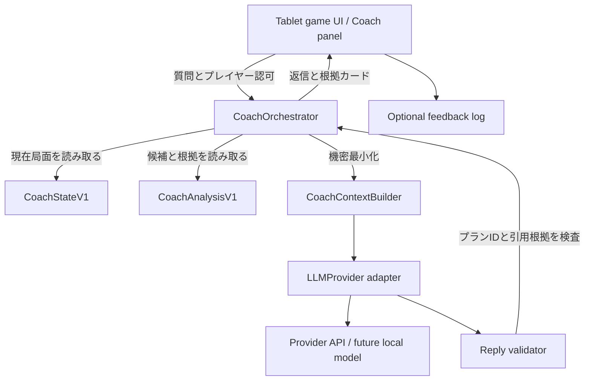

# Terraforming Mars AI Coach — Phase 3 実行計画書

**文書ID:** TM-COACH-P3-MVP  
**作成日:** 2026-10-14  
**ステータス:** Iteration 0 完了（PR #8）。**Iteration 1 以降は [選択主導型の計画 TM-COACH-P3-CD](choice-driven-plan.md)（2026-10-16）に置き換え**  
**対象リポジトリ:** [yusei88/terraforming-mars](https://github.com/yusei88/terraforming-mars)  
**設計時の基準:** `main` = `969e918df7785b15878fa106e5950f87ce54e461`（Gate E マージ済み。着手時に更新を確認）  
**推奨ブランチ:** `coach/phase3-mvp`（小さなPRに分けて段階マージ）  
**構築対象:** 自宅G10上のゲームサーバー + タブレットブラウザ。外部AI利用は設定と明示的同意により有効化。

---

> **変更履歴**
> - 2026-10-16: Iteration 1 以降のユーザー体験、優先順位、モデル評価基準を [TM-COACH-P3-CD](choice-driven-plan.md) に変更した。この文書と矛盾する場合は TM-COACH-P3-CD を優先する。
>   - 自由質問のチャット（§4〜§6 の `question`/`hint`/`compare`/`explain`）は、補助機能として残す。
>   - 主な体験は「ゲームの選択肢を見る → プレイヤーが選ぶ → その選択へのコーチング」にする。
>   - 実装上の決定は [choice-driven-design.md](choice-driven-design.md) に記録する。
>   - Iteration 0 の成果（ADR、評価データ、UX の決定、接続部品）はそのまま使う。

---

## 0. エグゼクティブサマリー

### 今回の方針変更
従来の「Gate F：表示UI」「Phase 3：問いかけ、LLM、振り返りを順に実装する」という工程を取りやめ、**AIとUIをつないだ利用可能な最小製品（MVP）を、早期に一本通す**方針に変更する。

新しいPhase 3は、次の4つのIterationで実施する。

1. **Iteration 0：AIとUXの小規模な比較実験。** 同一の実局面・質問を使ってLLMと画面設計を比較し、最小構成を選択する。
2. **Iteration 1：一気通貫MVP。** ゲーム画面 → 分析エンジン → AI → 根拠検証 → タブレット表示 → 追加質問、までを実装する。
3. **Iteration 2：実プレイでの価値検証。** ソロ・対人の対局で有用性を評価し、エラーと利用フィードバックを収集する。
4. **Iteration 3以降：評価駆動の改善。** 何を開発するかは観測結果に基づいて決め、あらかじめ機能の詳細を固定しない。

**MVPの合格条件:** 実際のゲームを操作しながら、現在の戦略を質問し、複数プランの違い・不足条件・根拠を確認し、追加質問してプレイを続けられる。ゲーム進行にはAIの故障が一切影響しない。

### 採用を見送るもの
- すべてのカードの完全な効果解析、完全最適解や勝率の算出。
- ゲームのAI自動操作、リプレイ分岐探索、対戦AI、長期記憶や自動学習。
- 大掛かりなマルチエージェント基盤・RAG基盤・ベクトルDB。
- 本人のゲーム操作と競合する自動ポップアップや頻繁なAIの割り込み。
- AI応答の全文や私的な手札を、同意なく永続ログや外部サービスへ送ること。

---

## 1. 現状と技術的前提

### 1.1 利用できる実装

| 実装 | 対象 | 再利用方法 |
|---|---|---|
| `CoachStateV1` | `GET /api/coach/state?id=...` | プレイヤー視点の現在状態（状態指紋） |
| `CoachCatalog` | `GET /api/coach/catalog` | カードの実ルールを出典とする機械可読カタログ |
| `CoachTrace` | `GET /api/coach/decisions?id=...` | 本人の過去の判断・Undo・巻き戻り情報。MVPでは必須入力ではない |
| `CoachAnalysisV1` | `GET /api/coach/analysis?id=...&horizon=0..3` | 既知カードによる最大3枚の候補プラン、費用・条件・世代予測・根拠・未対応理由 |
| 既存拡張機構 | `src/client/extensions/ClientExtension.ts`、`App.vue` | ゲーム本体への変更を最小にしてコーチパネルを追加 |
| 既存サーバー拡張 | `src/extensions/coach/extension.server.ts` | 本人認可を踏襲した新しい読み取り／相談エンドポイントを追加 |

既存の分析は、全探索による最適解ではない。現時点の上限はおおむね **手札等から40枚、5,000チェーン、150ms、返すプラン9案**。一部のカード固有効果、タイル配置、任意の青カードアクション、未知の山札、対人戦の終了時期は完全には計算できない。

したがってLLMの仕事は「既存の分析を読み解き、比較し、プレイヤーの質問に答えること」。**エンジンに存在しない最適値、勝率、費用を計算済みの事実として提示しない。**

### 1.2 既存の品質証跡（設計時のリポジトリ報告に基づく）
- Coachテスト157件成功、実機照合8,463件で失敗0。
- 分析APIのHTTP P95は5.8〜8.2ms（G10と同一ホストからの測定）。**タブレットWi-FiとLLMを含む応答時間ではない。**
- 全体サーバーテストは7,874件成功・既存のAI対局タイムアウト1件、クライアントVitest終了時エラーとCSS Lint既存問題あり。
- Gate F（最小UI）未実装。Phase 3の新機能は未実装。

### 1.3 開発の基本原則
1. **薄いオーケストレーター**、既存ゲーム・分析ロジックは再実装しない。
2. **垂直スライス**で1本ずつ使えるようにする。モデルやUIの完全決定を待ちすぎない。
3. **ユーザーの判断主体性**。標準では問いかけを優先し、希望があれば直接比較・解説する。
4. **計算値の出典**を分離。LLMは解釈担当、数値とカード・プランの正本はサーバー。
5. **後方互換とゲーム保護**。LLM接続を無効化・遮断してもゲームとCoachAnalysisは動作する。
6. **匿名化・最小送信**。LLMへプレイヤーID・ゲームID・他人の非公開情報・山札順序を渡さない。

---

## 2. MVPのユーザーストーリーと受入条件

### US-01：現在の戦略を相談
ゲーム画面の「Coach」起動操作から、現在の局面について「今は何を優先するとよい？」と質問する。
- 利用可能な分析プランから最大3件を選び、プランごとの長所・弱点・必要条件を説明。
- プランがない、候補が探索上限で切られている場合は、その事実を説明。
- プレイ可能性を `legal-now` / `conditional` / `unknown` の定義を越えて断定しない。

### US-02：プレイヤーの仮説を検討
「科学タグを優先したい」「カードAとBならどちらがよい？」等の自由質問に回答する。
- 質問が既存の候補・データの範囲にある場合は根拠付きで比較。
- 候補外や解析不能な対象では、足りない情報と何を確認すべきかを示す。
- 相談が連続しても、会話相手と現在ゲーム状態を混同しない。

### US-03：不足条件を知る
「このカードを使うまでに何が必要？」に対し、カードの要件ギャップ、資金・生産力・条件付きの項目を表示。
- 確定した数値は分析APIの値を画面で描画する。
- 他のカードをプレイすれば満たせるという説明は**条件付きプラン**として表す。

### US-04：ゲームを止めずに戻る
- タブレットの縦/横表示でパネルを開閉でき、手札・ターン操作が阻害されない。
- AI失敗・APIタイムアウト・オフライン時でもゲーム操作を続行可能。
- タブを閉じて戻った場合、通常のプレイヤーURLによる復帰を妨げない。MVPでは会話履歴の永続復元は必須としない。

### US-05：助言を評価する
- 回答ごとに「役立った／違うと思う」と理由カテゴリを付けられる。
- 送信する場合は明示的に許可した最小の評価メタデータに限る。
- 評価したことだけで、自動的なモデル学習やコード変更を行わない。

---

## 3. Iteration 0 — AI技術・UIの選定実験

### 3.1 実験のねらい
性能や価格の一般ランキングではなく、**既存のCoachAnalysisデータを与えたときに、説明と問いかけが役立つか**を比べる。

### 3.2 AI候補
- **候補A:** OpenAI API の低遅延・低価格帯のテキストモデル。
- **候補B:** Anthropic Claude API の低〜中価格帯のモデル。
- **参考:** Google Gemini API の軽量モデル、将来のOllama／LIRA経由ローカルモデル。

採用モデルの正確な識別子、価格、構造化出力制限、推奨SDKは **Iteration 0実施時に各公式資料で再確認**してADRに固定する。価格変動に弱いのでモデル名を本計画にハードコードしない。比較する主軸は構造化出力、応答品質、初回応答時間、運用単価、機密情報の扱い、SDKの運用性とする。

参考資料:
- OpenAI structured outputs: https://platform.openai.com/docs/guides/structured-outputs
- Anthropic structured outputs: https://platform.claude.com/docs/en/build-with-claude/structured-outputs
- Gemini structured outputs: https://ai.google.dev/gemini-api/docs/structured-output

### 3.3 評価データ
- **20〜30局面**を選定。序盤/中盤/終盤、ソロ/対人、既知・一部未知、コンボ有無、Undo、候補打ち切り、局面が変わるケースを含める。
- 初回はテスト専用ゲームから作成した非実ユーザーのデータを使う。実対局データを外部AIへ送る場合は明示的許可が必要。
- 各局面で「今どうする？」「AとBの比較」「不足条件」「実行できないプランへの疑問」等、同じ質問を各モデルに与える。
- 同じ最小入力JSON、ほぼ同じ指示、温度・出力制限・タイムアウト条件に統一。少なくとも各ケース2回実行して揺れを確認する。

### 3.4 評価観点と選定ルール

| 軸 | どう測るか | 必須条件・基準 |
|---|---|---|
| 事実の正確性 | 記載したプランID・カード・数値・要件を元データと照合 | **架空のカード/費用の断定0**を出荷ゲートとする |
| 非対応の尊重 | `unknown`、`partial`、`truncated`局面を与える | 不明を勝手に埋めない |
| コーチ品質 | 人が「理解を深める/判断に役立つ」を0〜2で評価 | 意味のある助言が多い候補を優先 |
| 対話の自然さ | 日本語の短さ・押しつけの少なさ、追質問 | 自然さを定性評価 |
| レイテンシ | 応答開始・完了のP50/P95 | タブレット操作で待てるか実機検証 |
| コスト | 実トークン利用量 × 公表単価で1対話当たり算出 | 利用上限を構成できること |
| 安全性 | 未認可ID・秘密情報・プロンプト注入例 | 個人情報漏えい・不正操作0 |
| 保守性 | SDK、API変動、構造化出力互換性 | Provider交換が可能 |

定量スコアで優勝を機械的に決めず、**正確性と情報保護のゲートに通った候補同士**で有用性・価格・速度を比較する。ハードゲートに通らなければ強力なモデルでも不採用。

### 3.5 UXの小規模比較
以下の2案を**実機で早期確認**。
- A: 画面端のCoachボタン → 縦画面はボトムシート、横画面はサイドパネル。おすすめ質問ボタン + 入力欄。
- B: 常設の小さな戦略サマリー + 詳細シート。

**MVPの暫定採用はA。** 常設情報は盤面やカード操作を遮る可能性が高い。試すべきことは「開きやすさ」「閉じやすさ」「カード参照と会話の往復」「重要な操作を隠さないか」。

### Iteration 0の完了成果
- `docs/coach/phase3/adr-provider.md`：プロバイダー採用根拠・比較表・非採用理由。
- `docs/coach/phase3/evaluation-dataset.md` と秘密を含まない局面フィクスチャ。
- `docs/coach/phase3/ux-decision.md`：縦/横画面の採用方針。
- **必ず1局面のPoCで実際にAPI接続を成功**させ、机上選定だけで終えない。

---

## 4. Iteration 1 — 一気通貫MVPの技術設計

### 4.1 論理構成



- `CoachOrchestrator`はプレイヤーの現在状態をサーバー上で解決し、本人認可を毎リクエスト確認する。クライアントが送った`CoachStateV1`の全文を信用しない。
- `CoachContextBuilder`は生成用の短い文脈を作る。ゲームID・プレイヤーID・相手の秘密・山札順・RawTraceを一切含めない。
- `LLMProvider`は `generate(request): Promise<ProviderResult>` 等の単純な共通インターフェース。複雑なエージェントフレームワークを導入しない。
- `ReplyValidator`はレスポンスの構造、回答中の参照IDが当該分析に存在すること、利用者に見せられる範囲、古い局面の判定を検証。
- **数値・カード・プラン・費用の「事実カード」は必ずサーバーが構造化データから描画**。LLM文章に根拠のない数値を出さないための入力・出力制約とQAも設ける。

### 4.2 Provider抽象化（案）

```ts
interface CoachLLMProvider {
  id: string;
  generate(input: {
    instructionsVersion: string;
    language: string;
    question: string;
    compactContext: CoachLLMContext;
    recentConversation: Array<{role: 'user' | 'assistant'; text: string}>;
    abortSignal?: AbortSignal;
  }): Promise<{
    structuredReply: unknown;
    usage: {inputTokens?: number; outputTokens?: number};
    timing: {elapsedMs: number};
  }>;
}
```

`CoachLLMContext` は `CoachAnalysisV1` の全文コピーではなく、候補ID・目標・リンク・blocker・availability・complete・limitationsなどの**必要部分を抽出した版**。シンプルな文脈でトークンコストを下げる。取り出せない内容は「情報がない」と返す。

最初は **1 Provider + deterministic fallback** で出荷する。ベンチマークに使う第2 Providerをプロダクションへ常時組み込む必要はない。配信/ストリーミングは品質・遅延計測から価値がある場合のみ次PRで足す。構造化出力を一括で受け取り検証してから描画する方法をMVPの基本とする。

### 4.3 API追加（提案契約）

```text
POST /api/coach/chat?id=<playerId>
Content-Type: application/json
{ "question": "...", "mode": "question|hint|compare|explain",
  "seenFingerprint": "<sha256>", "sessionId": "<opaque>", "horizon": 3 }

Response (概念例):
{ "schemaVersion": "coach-chat/1", "status": "ready|stale|fallback",
  "source": { "fingerprint": "...", "advisoryFingerprint": "...", "analysisVersion": "..." },
  "reply": { "message": "...", "planIds": ["..."], "evidenceRefs": ["..."],
             "followUpQuestions": ["..."] },
  "uiFacts": [{ "planId": "...", "fields": ["..."], "source": "coach-analysis/1" }],
  "diagnostics": { "category": "none|timeout|validation|provider|limit" } }
```

- 既存 `CoachPlayerHandler` の認可・本人照合に準拠（実装時にPOST向け共通化）。一方、将来的にプレイヤーIDをクエリへ置かずに渡す方法も検討し、少なくともアクセスログ・エラー・外部LLM送信からIDを除去。
- `question`文字数、会話件数、出力長、接続タイムアウト、分当たりリクエスト数、セッション利用量を制限。
- サーバーで状態取得後に生成し、返送直前にも現状態を確認。**違っていたら旧回答をそのまま「最新の助言」と表示しない**（`stale`として更新ボタンを示す）。
- セッションはプロセス内で短期保持から開始。プロセス再起動やタブ閉じで会話が消えてもMVPの仕様とし、説明する。
- `Cache-Control: no-store`、外部のCookie/トークンの共有なし、ゲーム状態への書込みゼロ。
- `POST /api/coach/feedback?id=<playerId>` は任意実装。評価記録を有効化した場合のみ、認可・データ最小化・ID匿名化を行う。

### 4.4 推奨する応答の契約

**LLMの自由文は「考え方・問いかけ」、ゲームの事実は構造化された `uiFacts` のみで描画する。**
- 参照できるカード名/プランIDは渡したContext内のものに限定。
- `unknown`や`partial`の効果を、計算された確定利益として扱わない。
- プレイヤーの仮説に反論できる。ただし根拠と反例を付け、決めつけない。
- 対話モードを `question`（問いかけ）、`hint`、`compare`、`explain` に限定。
- 「最適解」「勝率80%」等、エンジンが根拠を出していない表現は不可。
- モデルはゲーム処理を呼び出せず、`PlayerInput`や`Game.play()`に接続するツールも与えない。

### 4.5 失敗時の仕様（最初から組み込む）

| ケース | 振る舞い |
|---|---|
| AI未設定/外部送信未承認 | LLMへ接続せず、Phase 2の分析候補と根拠を表示 |
| 接続/タイムアウト/5xx/制限 | 回答なしのエラーを出すか、確定的な分析の簡易要約へフォールバック。**生成成功を偽装しない** |
| 構造化出力不正、存在しないプラン参照 | 回答を棄却、正本の分析表示へフォールバック |
| 生成中の局面更新/Undo | stale表示と再取得の提案。古い提案は最新結果として扱わない |
| 相手の秘密やIDを要求する質問 | 非公開情報は取得・送信せず、アクセスできる情報の範囲だけで回答 |
| UIを閉じる/画面遷移 | 可能ならAbort。ゲームのターン操作は影響を受けない |
| 同時連打/多重要求 | 同じセッション内は一度に1生成。レート制限と重複排除 |
| 予算超過 | そのセッションのLLM処理を停止し、分析表示は継続 |

---

## 5. UI/UXのMVP仕様

### 5.1 主画面
- デフォルトは**コーチ閉状態**。ゲーム画面の端に小さな「Coach」起動ボタンを表示。
- タブレット縦画面では画面下から上がるシート、横画面では幅を制限したサイドパネル。
- 上段: 現在の局面に関する短い案内/状態。中段: 3つまでの異なる目標のプラン概要。下段: 「今どうする？」「A/Bを比較」「不足条件」「自由に質問」など。
- 詳細: プランのカード順、合法性、費用・予測、unmodeled理由、エビデンス/前提。
- 相談応答に必要な根拠はカード表示に紐づけ、原則としてタップで展開。カードを参照するためにゲームを完全に覆わない。

### 5.2 UXの状態遷移
`closed → open → loading-analysis → ready → generating → answered`を基本とし、`stale`、`offline`、`fallback`、`disabled`、`error`を明示する。回答ごとの評価は任意。パネルを閉じてもゲームは通常どおり動作。

### 5.3 更新契約
- ゲーム画面から渡される `view` の更新を検知。ユーザー操作後に、同一プレイヤーの `GET /api/coach/analysis` を再取得。
- 新旧の `source.fingerprint` / `advisoryFingerprint` / `analysisVersion` を照合。古い結果は表示を保留または「以前の局面」と表示。
- **タブレットからAIの更新を促すために過剰な高頻度ポーリングを追加しない。** 初期の更新時は明示的再読込みも許容。

### 5.4 多言語と表示
- リポジトリ `CLAUDE.md` のルールに従い、静的UIの可視文言は同一変更で **全16言語**に翻訳。
- 既存 `CandidatePlan.question.key/params` や、これから追加する理由コードをベースに多言語化。API内の既存英語の `why`、`reasons`、`warnings` 等を、ローカライズ済みの正式UI文言としてそのまま表示しない。
- LLM応答の対象言語はプレイヤーのUI言語。ただしMVPの自然言語の品質評価は**日本語中心、英語で最低限の回帰確認**とする。UI静的文言の全16言語対応とは別に評価する。
- 数値・単位・カード表記はゲーム本体の既存表示ロジックを再利用。

### 5.5 実装パス（目安）
```text
src/extensions/coach/
  extension.client.ts
  common/CoachChat.ts
  client/CoachLauncher.vue
  client/CoachPanel.vue
  client/CoachPlanCard.vue
  client/coachClient.ts
  server/chat/CoachOrchestrator.ts
  server/chat/contextBuilder.ts
  server/chat/replyValidator.ts
  server/chat/providers/LLMProvider.ts
  server/chat/providers/<selectedProvider>.ts
  server/chat/fallback.ts
  server/chat/metrics.ts
  server/routes.ts                 # 新しいPOSTエンドポイント

src/locales/<16言語>/fork_ui.json  # 同じPRに含める

tests/extensions/coach/chat/
tests/client/extensions/coach/
docs/coach/phase3/
```

実際のファイル名はリポジトリ規約に合わせる。`src/tools/make_extensions.ts`による拡張レジストリ生成を使用し、生成物を手編集しない。サーバーだけでなくビルド・UIの端末検証を同一Iterationで実施。

---

## 6. Iteration 1のPR分割と各ゲート

**PR #P3-1 — 一本つながる縦切りの試作**
- 単純な1局面の相談：画面のボタン → サーバー → Phase 2 Analysis → 1 Provider → 基本的な返答表示。
- 実認可とゲームへの副作用ゼロ。APIキーはサーバー側、外部送信は明示承認。
- 完了: タブレットで1回の対話を実際に行える。全機能の完成を待たず早期に動かす。

**PR #P3-2 — 根拠・不確実性・局面更新の品質ゲート**
- Schema validation、カード/プランID検査、数値カード描画、未対応理由、stale対策、フォールバック。
- 完了: ミスリードしやすい20〜30局面を使った回帰が通る。

**PR #P3-3 — 実利用できるUX**
- 横/縦パネル、質問プリセット、自由入力、比較カード、詳細、取消/閉じる/読み込み中状態、全16言語のUI翻訳。
- 完了: ソロと2人対戦でタブレット操作を邪魔しない。

**PR #P3-4 — 評価・運用の最小実装**
- ユーザー評価、エラーカテゴリ、匿名メトリクス、費用制限、使い方・外部データ送信の説明。
- 完了: 改善対象を観測できる。

PRはレビュー可能な規模を優先するが、**PR間の設計整合性よりも早く実機に動作を届けること**を重視。不要な抽象化・Provider実装の増加は避ける。

---

## 7. Iteration 2 — 実利用評価

### 7.1 実施するゲーム
- ソロの基本セットを中心に、**少なくとも3回のプレイセッション**で試す（1回は複数世代にわたる継続利用）。
- 可能なら対人2人ゲームでも1セッション。共有情報しか漏れないか確認。
- 正答が明瞭な評価局面と、カード固有効果で不確実な局面を混ぜる。

### 7.2 定量ログ（個人情報を含めない）
収集可否はユーザーに委ね、既定では詳細な対話本文を保存しない。セッション単位の匿名識別子と以下を記録。
- `coach.opened`、`question.submitted`、`reply.completed/failed/stale/fallback`、`feedback.submitted`
- `mode`（question/hint/compare/explain）、`provider/model alias`、`durationMs`、入力/出力トークン、推定費用、エラー種別
- `evidenceValidationFailures`、`planCount`、`forecastComplete`、`searchTruncated`
- 回答評価：役立った／違う、カテゴリ（説明/事実/戦略/操作性/速度/その他）

ID・APIキー・プレイヤー名・生の手札・メッセージ原文を原則ログに含めない。詳細な再現が必要な場合は明示的に再現パックを作り、保存先を0700/0600相当で保護する。

### 7.3 判定のための指標
- **安全性:** 権限逸脱0、ゲーム状態変更0、外部ID漏えい0。
- **正確性:** `uiFacts` の参照不一致0、確定数値の捏造0。誤りが出たら出荷を停止して再発防止テストを追加。
- **利用性:** 実プレイでの相談成功率、パネルを開けた回数、助言からの再質問回数。
- **有用性:** 評価が付いた回答の中で「役立った」が占める率に加え、**低評価理由の実例**を重視する。標本が少ない段階では絶対的な割合の目標を立てない。
- **快適性:** タブレット上の生成待ち時間、表示崩れ、ゲーム操作の邪魔がないか。
- **経済性:** 1回の対話の推定費用と利用上限到達率。

### 7.4 評価からの改善先振り分け
| 観測された問題 | 次に変更する場所 |
|---|---|
| 会話が役に立たない/冗長 | プロンプト・モデル・UX |
| 根拠なしで数値を断定 | 出力検証・入力縮約・Provider選定 |
| 正しいが当然の提案ばかり | 分析の候補順位、目的の多様化 |
| 長期のコンボを見つけない | Phase 2の探索範囲・評価関数（**次Iterationで必要性を判断**） |
| 分析が未対応として止まる | 頻出カードに絞ったアダプタ、ルール拡充 |
| 不要なタイミングで開かれる | 起動UI、デフォルト閉、発話頻度 |
| 応答が遅い | 軽量モデル、入力縮約、部分表示、ストリーミング |
| 情報保護を優先してクラウドを使いたくない | ローカルモデル接続の比較・最適化 |

**Iteration 3のバックログはここで確定する。** 学習機能や完全最適探索を、MVP段階で固定ロードマップに載せない。

---

## 8. 受入テスト一覧

| ID | テスト | 期待 |
|---|---|---|
| M01 | 認可された本人がゲーム中に相談 | 現在本人のAnalysisだけを入力に回答 |
| M02 | 他プレイヤー/観戦者IDによる問い合わせ | 本人の手札・回答を取得不可 |
| M03 | 外部AI未許可・キー未設定 | 外部送信0、分析のみ表示 |
| M04 | プランが1件もない | 「候補なし」と説明し、架空プランを作らない |
| M05 | `complete:false` | 総利益を確定値として断定しない |
| M06 | `unknown`カード/条件 | 必要情報がないことを説明 |
| M07 | プランID・カード名の捏造 | ReplyValidatorが拒否する |
| M08 | 未対応効果が利益に関与 | 誤ったMC回収/VPを確定表示しない |
| M09 | 今すぐ合法ではないプラン | `legal-now`と誤表示しない |
| M10 | 問いかけ/ヒント/比較/説明 | モードに応じて適切な種類の応答 |
| M11 | 質問直後に別カードをプレイ | 古い回答はstaleになり最新扱いされない |
| M12 | Undoで同一に見える局面へ戻る | 局面/分析バージョンを確認し、古いセッション文脈を検証 |
| M13 | LLMタイムアウト・拒否・5xx | ゲーム操作は継続、分析表示へフォールバック |
| M14 | 連続タップ・二重リクエスト | 多重課金/複数生成を抑止 |
| M15 | セッション費用/回数上限 | 上限で外部呼出し停止 |
| M16 | 入力にプロンプト注入や秘密情報要求 | 認可と許可ツールを越える行動なし |
| M17 | 不正JSON・異なるSchema | 回答を安全に棄却 |
| M18 | クライアントが画面を閉じる | 操作継続、更新/リクエストの安全な扱い |
| M19 | タブレット横/縦レイアウト | 視認性・開閉・カード操作が成立 |
| M20 | i18n | `lint:i18n`成功、追加UI文言は16言語対応 |
| M21 | ソロ複数世代 | 連続相談しても現在局面の根拠に追従 |
| M22 | 対人2人 | 相手の非公開手札・山札順序を外部送信しない |
| M23 | JSON分析のみ利用 | LLMなしでも根拠/プランを読める |
| M24 | 評価の入力と保存無効 | プライバシー設定に従って適切に扱う |
| M25 | 既存のCoach回帰 | Phase1・1.5・2のテストに新たな失敗を作らない |
| M26 | ゲームAPIへの非干渉 | AI処理前後でシリアライズ済みゲーム状態が同一 |

QAではプレイヤー識別子やAPIキーを含む証跡をリポジトリへコミットしない。E2E用のダミーIDと再現性のあるテスト専用ゲームを利用。

---

## 9. 運用・非機能要件

### 9.1 設定案
```text
COACH_AI_ENABLED=false
COACH_AI_PROVIDER=<selected-provider>
COACH_AI_MODEL=<selected-model>
COACH_AI_API_KEY=<secret>     # 実際の変数名はProviderごとに整理
COACH_AI_EXTERNAL_ALLOWED=false
COACH_AI_TIMEOUT_MS=<configurable>
COACH_AI_MAX_OUTPUT_TOKENS=<configurable>
COACH_AI_RATE_LIMIT=<configurable>
COACH_AI_SESSION_BUDGET=<configurable>
COACH_FEEDBACK_ENABLED=false
```
設定値と単位はIteration 0で決め、`.env.example` と運用マニュアルに記載。**デフォルトはAI外部通信無効。** `.env` と秘密はGit管理しない。G10のDocker/非Docker両方で設定と遮断を確認。

### 9.2 サーバーの安全性
- ゲーム本体とLLM障害を隔離。分析/生成処理がPlayerInputハンドラや盤面更新をブロックしない。
- リクエストのタイムアウトとAbort。外部送信内容、応答トークン、失敗種別、利用料金を把握可能にする。
- ログに認可用プレイヤーID・APIキー・生のプロンプト/回答を出さない。
- 外部通信をやめても既存ゲームが成立することを確認。
- LAN・Cloudflare Tunnel等の公開境界で秘密のプレイヤーURLを扱うため、本人認可とアクセスログの取り扱いをレビュー。

### 9.3 性能とコストの目標
- 既存分析APIの性能・テスト品質を退行させない。
- LLMのP50/P95応答時間と課金を実測し、**このゲームのタブレット利用で支障のない水準**をIteration 0/2で定義。事前に保証できない数値を契約として固定しない。
- セッションあたり回数・トークン・費用上限を設定可能にし、上限時も無課金の分析表示は継続。

### 9.4 セキュリティ検証
- 型が正しくてもLLMの事実が正しいとは限らない。構造化出力 + 存在するエビデンスへのリンク + レンダラによる数値表示 + テストの多層防御。
- サーバーが外部API呼び出し前に機密最小化を行う。ユーザー質問自体に個人情報が混入する可能性は画面で注意し、可能なら送信前表示・明示確認を設ける。
- 外部AIにプレイヤーの秘密ID/サーバー内のゲームURL/内部接続文字列を渡さない。

---

## 10. DoD（Phase 3の完了判定）

以下をすべて満たすこと。

1. **実用性:** タブレットで現在のゲームからCoachを開き、質問、回答、根拠表示、再質問、閉じる、プレイ続行ができる。
2. **選定の説明責任:** 最低2モデルで同じ局面ベンチマークを実施し、採用モデル・不採用理由・制約を記録。
3. **根拠:** 表示する定量的なゲーム事実はCoachAnalysis/Stateに紐づき、存在しないプラン・カードを受理しない。
4. **限界を守る:** `partial`/`unsupported`、対人の残世代 `unknown`、探索打ち切り等を無視しない。
5. **ゲーム保護:** AIがゲームルールや盤面状態を書き換えず、AI停止でもゲーム利用可能。
6. **認可とプライバシー:** 本人以外の秘密を取得できず、LLM外部送信は許可制、認可ID/鍵がログやモデルに渡らない。
7. **UX:** タブレットの縦/横で操作成立。UI新規文言は16言語に翻訳されている。
8. **運用:** 失敗時フォールバック、コスト/リクエスト制限、匿名化したメトリクス、ユーザー評価入力が存在する。
9. **実プレイ:** ソロの複数世代を含む最低3セッション、できれば対人1セッションを試し、**改善優先順位を評価から導出**できる。
10. **品質:** M01〜M26の検証、Coachの既存157件・主要ゲーム回帰とビルド/i18nの回帰を確認。既知の失敗はベースラインとの差分で分類。
11. **記録:** 採用決定・テスト・不具合・UX評価・次IterationのバックログをMarkdownで残す。

### 「次のフェーズへ進める」の意味
**Phase 3完了後は固定されたPhase 4機能群を自動開始しない。** ユーザーが対局で得た価値と、観測された欠点に基づき1〜3件だけ改善課題を選ぶ。次の例のうち価値が高いものを選択:
- AIプロンプト／モデル更新
- コンボ評価関数・プラン順位の改善
- タイル・固有フックの効果解析
- 履歴を使った振り返り
- 音声やローカル化（LIRA連携）

---

## 11. 実施順とClaude Codeへの実装依頼の境界

1. 着手時に `git status`、`git log`、最新`main`を確認。進行中のユーザーの対局やデータを壊さない。
2. `coach/phase3-mvp` を起点に、**最初はIteration 0の比較実験と最小PoC**を実施する。
3. 技術選定結果を `adr-provider.md` に残し、ユーザーの意図するプライバシー・費用方針と矛盾しない範囲で標準Providerを決定する。
4. 相談機能を縦に実装し、まず画面から実際に会話できることをデモする。
5. 事実検証・失敗対応・レート/予算制限・多言語・実機UXを足してMVPとして完成する。
6. その後は実際の対局評価を行い、改善は次Iterationの別PRにする。

### 成果物のファイル一覧
- `docs/coach/phase3/plan.md` （本計画）
- `docs/coach/phase3/adr-provider.md`
- `docs/coach/phase3/evaluation-dataset.md`
- `docs/coach/phase3/ux-decision.md`
- `docs/coach/phase3/api-contract.md`
- `docs/coach/phase3/qa.md`
- `docs/coach/phase3/operations.md`
- `docs/coach/phase3/feedback-review.md`
- `docs/coach/phase3/report.md`
- `docs/coach/phase3/next-backlog.md`

---

## 12. 論点と意思決定

### すでに方向性を決める事項
- 次は「分析エンジンの拡張」ではなく「AIとUIを接続した利用可能なMVP」。
- AIはStrategy Engineの代わりに数値・ルールを作らない。
- デフォルト閉のCoachパネルで、ユーザー主導の呼び出し。
- 最初は1 Provider + 代替表示。Provider交換可能性は最低限の抽象で確保。
- ローカルLLMや複数Providerの高度な運用はMVPの必須条件ではない。
- データの外部送信は初期無効、明示的許可後のみ。

### Iteration 0に委ねる事項
- 採用するモデルID、価格/速度の基準、温度・出力量等の具体値。
- 回答を一括返却するか部分ストリーム化するか（初期推奨は一括構造化出力）。
- UIの横・縦の詳細寸法や起動位置（実機のゲーム操作性から選定）。
- ベンチマーク上の合格数値と費用上限（実測・利用意向から定義）。

### 実利用後に委ねる事項
- 何枚先のプラン探索が必要か、カード固有効果をどこまで解析するか。
- レコメンドの自動提示、対話履歴の持続、戦略の反省会や学習機能の必要性。
- ローカルLLM移行、音声、LIRA連携、長期記憶。

**最終判断:** Phase 3の価値はLLMモデルの性能や画面の完成度そのものではなく、プレイヤーが現実の局面で「有用な戦略相談ができた」と感じ、次の開発投資を自分の利用経験から選べる状態に到達すること。
